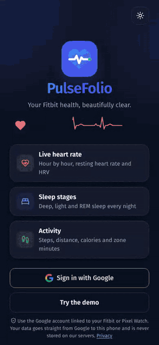

# Basivo Fit (PulseFolio)

**Your Fitbit health, beautifully clear.** An open-source, installable web app that shows the health data from your Fitbit or Pixel Watch: live heart rate, heart-rate zones, sleep stages, activity and vitals. It reads everything straight from the [Google Health API](https://developers.google.com/health) on your own phone.

- **No backend.** Your browser signs in with Google and reads your data directly. Nothing is stored on any server.
- **Installable.** Add it to the home screen on Android or iPhone and it opens full screen like an app (PWA).
- **Dark and light themes,** with smooth animations that respect "reduce motion".

<p align="center">
  <a href="docs/media/demo.mp4"></a>
  <br><sub>40-second tour with demo data. <a href="docs/media/demo.mp4">Watch the sharper MP4 version</a>.</sub>
</p>

> Not affiliated with Google or Fitbit. Not a medical device and not medical advice.

## Features

| Screen | What you see |
|---|---|
| **Sign in** | Sign in with Google. If the account has no Fitbit or Pixel Watch, a **No device connected** screen lets the user switch accounts. A demo mode works without signing in. |
| **Today** | Latest heart rate (checked every 20 seconds), steps ring, calories burned, today's heart-rate range, hourly activity, exercise days, last night's sleep and vitals. |
| **Heart** | Day and week views with your personal zone lines (light, moderate, vigorous, peak). The line changes colour by zone, and you can touch the chart to read any moment. Also time in each zone, resting heart rate and HRV. |
| **Sleep** | A stage chart (Awake, Restlessness, REM, Light, Deep) at the real times, plus a **Sleep quality** section that uses open, documented rules. Step back through earlier nights. |
| **Activity** | Steps by hour, steps by day against your goal, Active Zone Minutes, and heart rate through the day. |
| **Profile** | Connected device and battery, theme switch, switch account and sign out (sign out also cancels the app's access with Google). |

### What the Google Health API does not provide
**Sleep score**, **Readiness** and **Cardio load** appear in the Google Health app but are not offered by the API, so this app cannot show Google's numbers for them. The **Sleep quality** rules here are this project's own, and the app explains each one:

| Measure | How it is worked out | Typical range |
|---|---|---|
| Time to deep or REM sleep | From going to bed until the first deep or REM stage | under 30 min |
| Deep + REM sleep | Deep plus REM as a share of time asleep | 35–55% |
| Restlessness | Total of the short wake-ups the tracker reports | under 15 min |
| Interruptions | Wake-ups of 5 minutes or more during the night | under 10 min |

### How "live" is live?
The Google Health app talks to the band over Bluetooth. This app can only read what the band has uploaded to Google, which is usually a few minutes behind real time.

## Tech

React 18, TypeScript, Vite, `vite-plugin-pwa`, React Router, lucide icons and Fira Sans/Code fonts. Charts are hand-written SVG; there is no chart library.

```
src/
  lib/auth.ts          Google sign-in (OAuth 2.0 token flow, no client secret)
  lib/store.tsx        Loads data, refreshes it, handles "no device" and expired sign-in
  data/health.ts       Calls to the Google Health API (v4)
  data/heart.ts        Heart rate by day and week, zones, latest reading
  components/          Cards, charts, heart and sleep detail screens
  pages/               Today, Heart, Sleep, Activity, Profile, Login, Privacy
```

## Run it yourself

### 1. Google Cloud setup
1. Create a project in [Google Cloud Console](https://console.cloud.google.com/) and enable the **Google Health API**.
2. Under **Google Auth Platform**:
   - **Branding:** set the app name, support email, home page and privacy policy link (the app serves one at `/privacy`).
   - **Data access:** add these scopes:
     ```
     openid
     https://www.googleapis.com/auth/userinfo.email
     https://www.googleapis.com/auth/userinfo.profile
     https://www.googleapis.com/auth/googlehealth.activity_and_fitness.readonly
     https://www.googleapis.com/auth/googlehealth.sleep.readonly
     https://www.googleapis.com/auth/googlehealth.health_metrics_and_measurements.readonly
     https://www.googleapis.com/auth/googlehealth.settings.readonly
     ```
   - **Audience:** keep the app in **Testing** and add the Google accounts that may sign in as **Test users** (up to 100).
   - **Clients:** create a **Web application** client.
     - **Authorised JavaScript origin:** your site, for example `https://your-app.vercel.app`, plus `http://localhost:5173` for local work.
     - **Authorised redirect URI:** the same address with a trailing slash, for example `https://your-app.vercel.app/` and `http://localhost:5173/`.
3. Copy the **Client ID**. The app does not use the client secret; never put one in this app.

### 2. Run locally
```bash
npm install
cp .env.example .env.local   # then set VITE_GOOGLE_CLIENT_ID
npm run dev
```
Open http://localhost:5173. **Try the demo** works without any setup.

### 3. Deploy
Any static host works. On Vercel, import the repo with the **Vite** preset and add the `VITE_GOOGLE_CLIENT_ID` environment variable. `vercel.json` already handles page routing and caching.

## Going public
The health scopes are **restricted** by Google. While the app is in Testing, only listed test users (at most 100) can sign in, and they see a "Google hasn't verified this app" notice. Opening it to everyone needs Google's OAuth verification:
- your own domain
- a demo video
- a yearly **CASA** security assessment

## Privacy
- Data goes only from Google to the user's device.
- The sign-in token (about one hour), name, email, photo and theme choice are kept in the browser's local storage. Signing out deletes them and revokes access.
- The full policy is in [`src/pages/Privacy.tsx`](src/pages/Privacy.tsx).

## Contributing
Issues and pull requests are welcome. Please:
- keep the app backend-free
- keep text in plain language
- test both themes at phone width

## License
[MIT](LICENSE)
